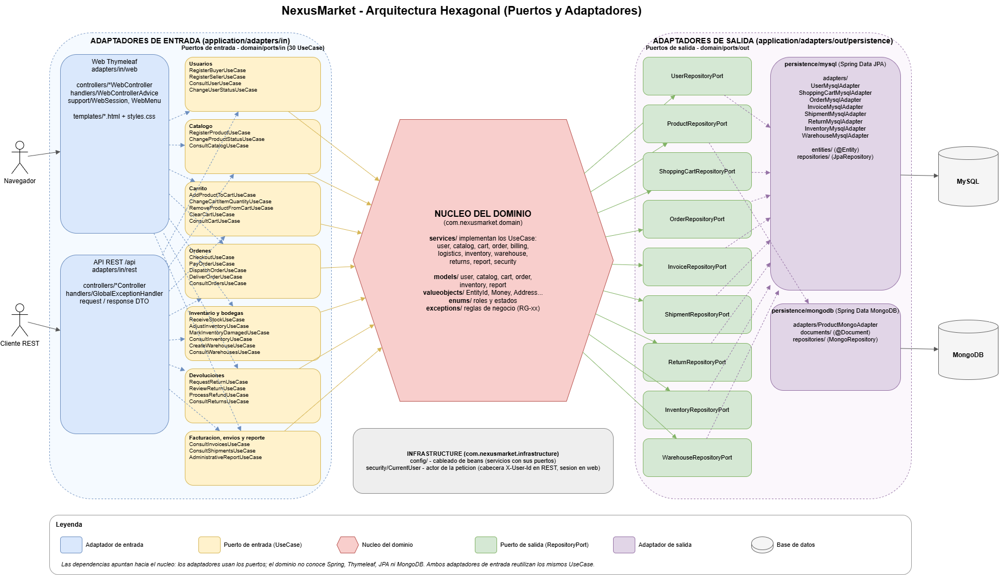

# NexusMarket

Plataforma digital centralizada que facilita la intermediación comercial entre compradores y vendedores

## Arquitectura hexagonal (puertos y adaptadores)

Las dependencias apuntan hacia el nucleo: los adaptadores usan los puertos y el dominio no conoce Spring, Thymeleaf, JPA ni MongoDB. Los dos adaptadores de entrada reutilizan los mismos UseCase.

```mermaid
flowchart LR
    browser(["Navegador"])
    client(["Cliente REST / Swagger"])

    subgraph IN["Adaptadores de entrada - application/adapters/in"]
        web["Web Thymeleaf<br/>adapters/in/web<br/>*WebController, WebControllerAdvice<br/>WebSession, WebMenu"]
        rest["API REST /api<br/>adapters/in/rest<br/>*Controller, requests, responses<br/>GlobalExceptionHandler"]
    end

    subgraph PIN["Puertos de entrada - domain/ports/in (30 UseCase)"]
        pu["Usuarios<br/>RegisterBuyer, RegisterSeller<br/>ConsultUser, ChangeUserStatus"]
        pc["Catalogo<br/>RegisterProduct, ChangeProductStatus<br/>ConsultCatalog"]
        pk["Carrito<br/>AddProductToCart, ChangeCartItemQuantity<br/>RemoveProductFromCart, ClearCart, ConsultCart"]
        po["Ordenes<br/>Checkout, PayOrder, DispatchOrder<br/>DeliverOrder, ConsultOrders"]
        pi["Inventario y bodegas<br/>ReceiveStock, AdjustInventory, MarkInventoryDamaged<br/>ConsultInventory, CreateWarehouse, ConsultWarehouses"]
        pr["Devoluciones<br/>RequestReturn, ReviewReturn<br/>ProcessRefund, ConsultReturns"]
        pf["Facturas, envios y reporte<br/>ConsultInvoices, ConsultShipments<br/>AdministrativeReport"]
    end

    core{{"NUCLEO DEL DOMINIO<br/>services: implementan los UseCase<br/>models, valueobjects, enums<br/>exceptions: reglas RG-xx"}}

    subgraph POUT["Puertos de salida - domain/ports/out"]
        rp["UserRepositoryPort<br/>ShoppingCartRepositoryPort<br/>OrderRepositoryPort<br/>InvoiceRepositoryPort<br/>ShipmentRepositoryPort<br/>ReturnRepositoryPort<br/>InventoryRepositoryPort<br/>WarehouseRepositoryPort"]
        pp["ProductRepositoryPort"]
    end

    subgraph OUT["Adaptadores de salida - application/adapters/out/persistence"]
        mysql["persistence/mysql<br/>*MysqlAdapter, entities, JpaRepository"]
        mongo["persistence/mongodb<br/>ProductMongoAdapter, documents, MongoRepository"]
    end

    dbm[("MySQL 8.4")]
    dbg[("MongoDB 7")]
    infra["infrastructure<br/>config: StartupInitializer, OpenApiConfig<br/>security: CurrentUser"]

    browser --> web
    client --> rest
    web --> PIN
    rest --> PIN
    PIN --> core
    core --> POUT
    rp -.-> mysql
    pp -.-> mongo
    mysql --> dbm
    mongo --> dbg
    infra -.-> core

    classDef inAd fill:#dae8fc,stroke:#6c8ebf,color:#000
    classDef port fill:#fff2cc,stroke:#d6b656,color:#000
    classDef dom fill:#f8cecc,stroke:#b85450,color:#000
    classDef outPort fill:#d5e8d4,stroke:#82b366,color:#000
    classDef outAd fill:#e1d5e7,stroke:#9673a6,color:#000
    classDef db fill:#f5f5f5,stroke:#666,color:#000
    class web,rest inAd
    class pu,pc,pk,po,pi,pr,pf port
    class core dom
    class rp,pp outPort
    class mysql,mongo outAd
    class dbm,dbg,infra db
```

Version Mermaid del diagrama

Colores: azul = adaptador de entrada, amarillo = puerto de entrada, rojo = dominio, verde = puerto de salida, morado = adaptador de salida, gris = bases de datos e infraestructura. Version editable en draw.io: [docs/arquitectura-hexagonal-nexusmarket.drawio](docs/arquitectura-hexagonal-nexusmarket.drawio).

## Ejecucion

1. Levantar las bases: `docker compose up -d` (MySQL en 3306, MongoDB en 27017).
2. Arrancar la aplicacion: `mvn spring-boot:run`.
3. Web: http://localhost:8080/ · API: http://localhost:8080/api · Swagger: http://localhost:8080/swagger-ui.html
4. Pruebas: `mvn test` (unitarias + integracion contra MySQL y MongoDB en bases `nexusmarket_test`) y `python scripts/smoke_test.py 100000 100001 100002`.
5. Guia de sustentacion: [docs/guia-sustentacion.md](docs/guia-sustentacion.md).

### Todo con Docker (sin Maven ni Java instalados)

`docker compose --profile app up -d --build` compila la app con el `Dockerfile` y levanta MySQL, MongoDB y la aplicacion en http://localhost:8080. Para ver el arranque: `docker compose logs -f app`. Para apagar: `docker compose --profile app down`.

## Configuracion (`src/main/resources/application.yml`)

| Propiedad                                       | Para que sirve                                                                                                                                  |
| ----------------------------------------------- | ----------------------------------------------------------------------------------------------------------------------------------------------- |
| `server.servlet.session.tracking-modes: cookie` | La sesion web viaja solo por cookie; evita URLs con `;jsessionid` que daban 404.                                                                |
| `spring.datasource.*`                           | Conexion a MySQL. Se puede cambiar con `MYSQL_URL`, `MYSQL_USER` y `MYSQL_PASSWORD`. `createDatabaseIfNotExist=true` crea la base si no existe. |
| `spring.jpa.hibernate.ddl-auto: update`         | Hibernate crea o ajusta las tablas a partir de las entidades JPA (pensado para desarrollo).                                                     |
| `spring.jpa.open-in-view: false`                | No mantiene la conexion abierta durante el render de la vista; los datos se cargan dentro del caso de uso.                                      |
| `spring.data.mongodb.uri`                       | Conexion a MongoDB (catalogo de productos). Variable `MONGO_URI`.                                                                               |
| `nexusmarket.seed.*`                            | Documento y correo de los usuarios internos que `StartupInitializer` crea al primer arranque.                                                   |

## Interfaz web

Con la aplicacion en ejecucion, abrir http://localhost:8080/ . La interfaz esta hecha con Thymeleaf (Spring MVC): es un segundo adaptador de entrada (application/adapters/in/web) que llama los mismos UseCase que la API REST de /api. Vistas en src/main/resources/templates.

- Ingreso con el id de usuario (queda guardado en la sesion web). Internos: 100000 Administrador, 100001 Operador Logistico, 100002 Supervisor.
- Los compradores se autorregistran desde la pantalla de ingreso; los vendedores los registra el Administrador.
- Las pestanas cambian segun el rol: catalogo, carrito y ordenes (comprador); productos e inventario (vendedor); despacho y entrega (operador logistico); usuarios, bodegas, devoluciones y reporte (administrador); solo consulta (supervisor).
